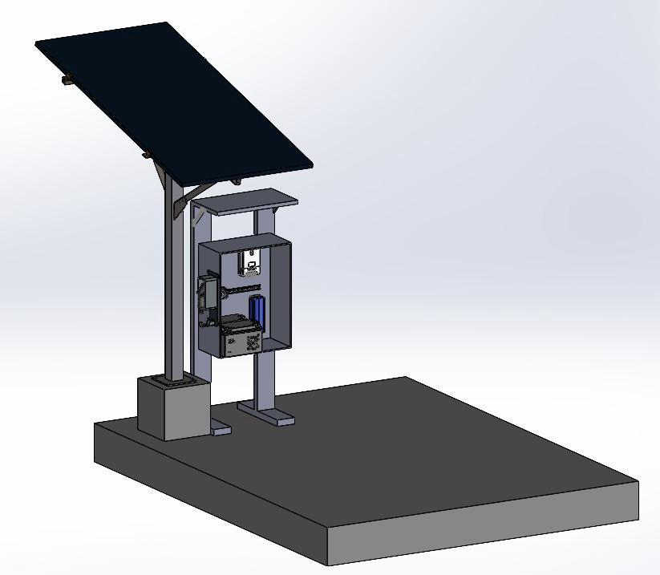
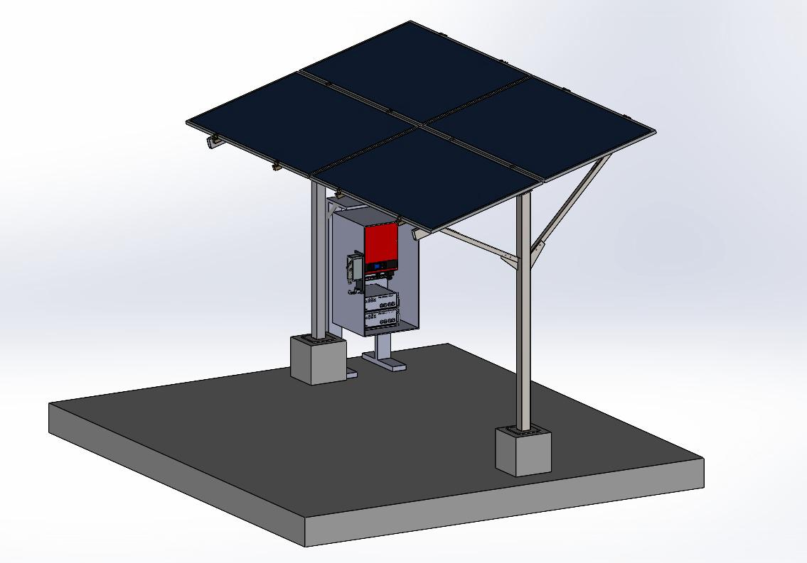
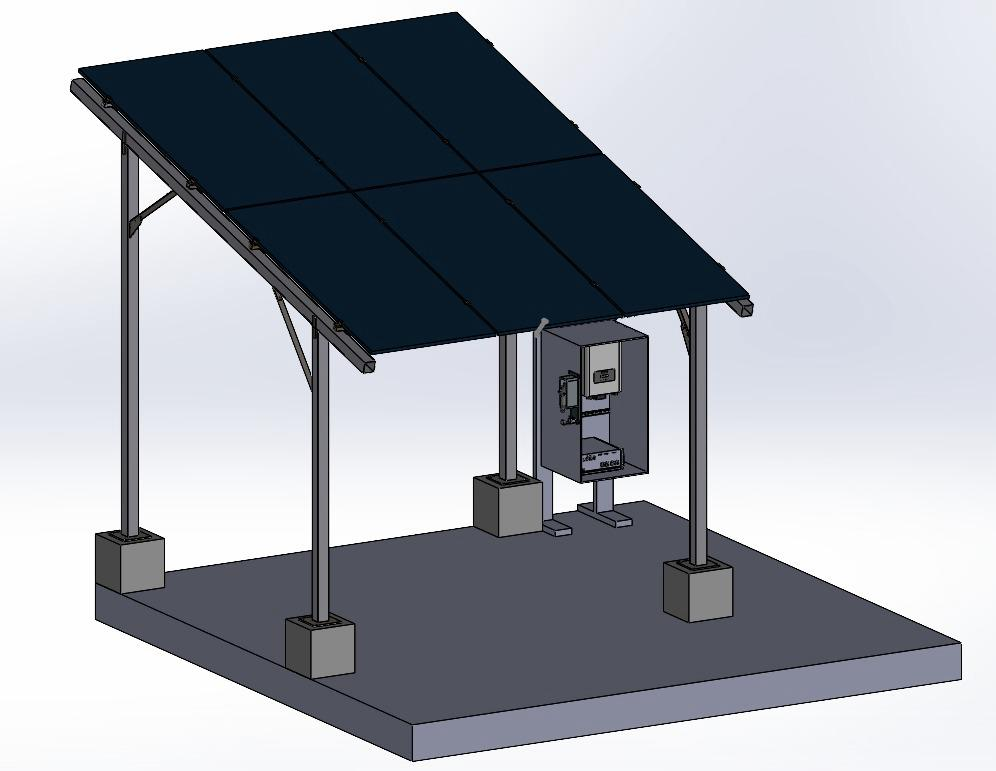
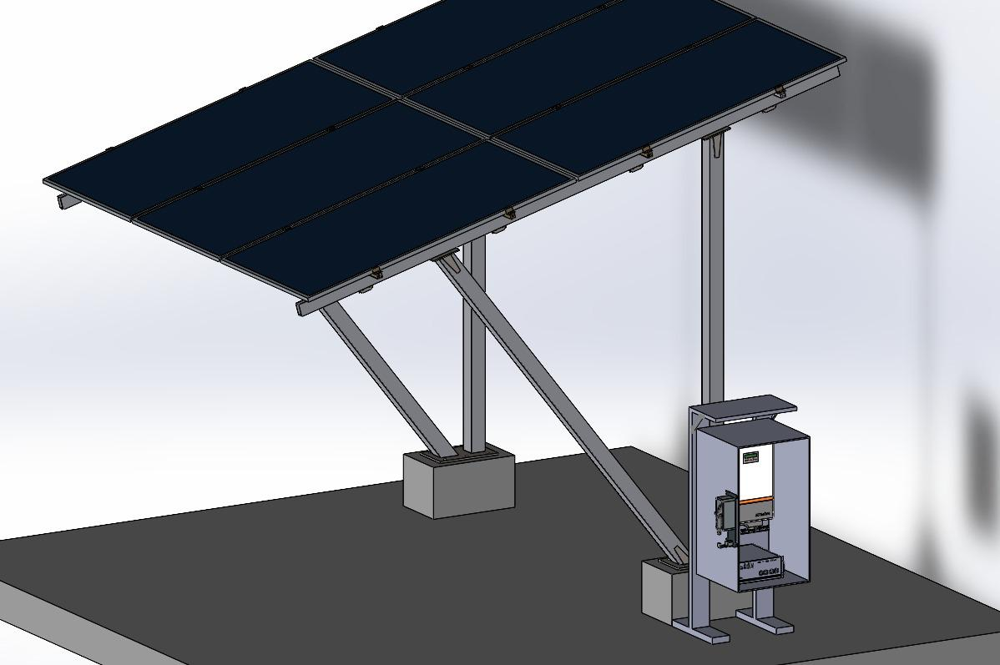

# Dimensionador y monitoreo de estaciones de carga solar

Plataforma web del proyecto de grado para explorar estaciones de carga solar, estimar sus componentes y consultar el dashboard externo de monitoreo en ThingsBoard.

**[Abrir la plataforma](https://mecatronicosolar.github.io/estacion-carga-dimensionador-y-monitoreo/)** · **[Usar el dimensionador](https://mecatronicosolar.github.io/estacion-carga-dimensionador-y-monitoreo/dimensionamiento.html)** · **[Consultar monitoreo](https://mecatronicosolar.github.io/estacion-carga-dimensionador-y-monitoreo/monitoreo.html)**

## Estaciones de referencia

El dimensionador permite comenzar desde cero o cargar los datos disponibles de uno de los cuatro diseños y modificarlos para comparar escenarios.

| 800 W | 3,7 kW |
| --- | --- |
|  |  |
| [Cargar ejemplo de 800 W](https://mecatronicosolar.github.io/estacion-carga-dimensionador-y-monitoreo/dimensionamiento.html?diseno=800w) | [Cargar ejemplo de 3,7 kW](https://mecatronicosolar.github.io/estacion-carga-dimensionador-y-monitoreo/dimensionamiento.html?diseno=3-7kw) |

| 7 kW | 11 kW |
| --- | --- |
|  |  |
| [Cargar ejemplo de 7 kW](https://mecatronicosolar.github.io/estacion-carga-dimensionador-y-monitoreo/dimensionamiento.html?diseno=7kw) | [Cargar ejemplo de 11 kW](https://mecatronicosolar.github.io/estacion-carga-dimensionador-y-monitoreo/dimensionamiento.html?diseno=11kw) |

Los archivos mecánicos completos están en el [repositorio de diseños CAD](https://github.com/mecatronicosolar/estacion-carga-solar-diseno-mecanico).

## Qué puedes hacer

- **Explorar los diseños:** consultar vistas CAD, componentes y presupuestos de referencia de las estaciones.
- **Estimar baterías:** ingresar potencia por vehículo, duración de la sesión, cantidad de vehículos simultáneos y datos de la batería.
- **Estimar paneles:** introducir las horas solares pico (HSP), la potencia del módulo y su categoría de tensión nominal.
- **Consultar el inversor:** obtener especificaciones preliminares según el escenario y la tensión de salida seleccionada.
- **Estimar conductores AC:** evaluar un circuito monofásico de cobre según potencia, tensión, distancia de ida y entorno de instalación.
- **Consultar monitoreo:** abrir el dashboard externo de ThingsBoard desde la plataforma o en otra pestaña.

## Cómo usar el dimensionador

1. Abre **Dimensionamiento** y elige una estación de ejemplo o comienza desde cero.
2. Completa **Baterías**, pulsando los botones de cada paso en orden. Ingresa potencia en W, duración en horas y vehículos como número entero.
3. En **Paneles**, registra las HSP de la ubicación y los datos del módulo; después revisa las opciones de arreglo.
4. En **Inversor**, selecciona la tensión de salida para consultar la especificación propuesta.
5. En **Conductores AC**, indica tensión, distancia de ida y entorno. La herramienta incluye el recorrido de retorno.
6. Usa **Borrar todo** para empezar otro escenario.

Ten a mano las fichas del cargador, la batería y el panel, además de las condiciones del lugar. Los ejemplos precargados no sustituyen esos datos.

### Ejemplo de energía

Una carga de **800 W**, durante **2 horas**, para **2 vehículos simultáneos** requiere:

```text
Energía requerida = potencia × duración × vehículos
                 = 800 W × 2 h × 2
                 = 3.200 Wh = 3,2 kWh
```

Esta es la energía de consumo del escenario; la selección de equipos debe considerar también pérdidas, capacidad utilizable y compatibilidad eléctrica.

## Alcance del cálculo

La herramienta sirve para **dimensionamiento preliminar y comparación de escenarios**. La versión guiada usa supuestos simplificados: profundidad de descarga de 0,5 para plomo y 0,8 para litio, y factor 1,25 para la estimación de generación fotovoltaica. No contempla de forma completa eficiencias, envejecimiento, reservas ni todas las restricciones de los equipos.

El módulo AC admite **110, 120, 220 y 240 V monofásicos**. No dimensiona el circuito **trifásico de 380 V de la estación de 11 kW**. Tampoco calcula el conductor de protección ni selecciona el interruptor o diferencial.

Antes de definir una instalación deben verificarse las fichas de los equipos, las condiciones reales del sitio, las protecciones y el diseño eléctrico completo. Los presupuestos mostrados son referencias del proyecto, no cotizaciones actualizadas.

## Monitoreo

La página de monitoreo incorpora un dashboard público externo de **ThingsBoard Cloud**, con opciones para reintentar su carga o abrirlo directamente.

Que el marco del dashboard cargue no confirma que la estación esté conectada ni que las mediciones sean recientes. El origen y la fecha de los datos se consultan en ThingsBoard. Esta web estática no implementa control físico del cargador ni acredita la conexión de sensores.

## Ejecutar en tu equipo

El proyecto utiliza **HTML, CSS y JavaScript**, sin proceso de compilación ni instalación de paquetes.

```sh
git clone https://github.com/mecatronicosolar/estacion-carga-dimensionador-y-monitoreo.git
cd estacion-carga-dimensionador-y-monitoreo
python3 -m http.server 8000
```

Abre [http://localhost:8000](http://localhost:8000). Para consultar el dashboard externo y los enlaces de referencia necesitas conexión a Internet.

## Archivos principales

| Archivo | Función |
| --- | --- |
| [index.html](index.html) | Presentación, estaciones de referencia y arquitectura prevista. |
| [dimensionamiento.html](dimensionamiento.html) | Dimensionador guiado de cuatro etapas. |
| [calculos-simple.js](calculos-simple.js) | Cálculos de energía, baterías, paneles e inversor del recorrido guiado. |
| [cables-ac-simple.js](cables-ac-simple.js) | Estimación de conductores AC monofásicos. |
| [plantillas-simple.js](plantillas-simple.js) | Precarga de datos de las cuatro estaciones. |
| [ayuda-simple.js](ayuda-simple.js) | Ayudas de uso del dimensionador. |
| [dimensionamiento-detallado.html](dimensionamiento-detallado.html) | Redirección de compatibilidad hacia el dimensionador actual. |
| [monitoreo.html](monitoreo.html) y [monitoreo.js](monitoreo.js) | Vista externa de ThingsBoard y estado de carga del marco. |

## Publicación

La plataforma se publica mediante **GitHub Pages** desde la rama `main`, carpeta raíz. Los cambios publicados en esa rama se reflejan en la web después del despliegue.

## Documentación del proyecto

- [Diseños mecánicos y ensamblajes CAD](https://github.com/mecatronicosolar/estacion-carga-solar-diseno-mecanico).
- [Diseño electrónico y documentación](https://github.com/mecatronicosolar/estacion-carga-solar-electronica).
- [Fichas técnicas de componentes](https://github.com/mecatronicosolar/estacion-carga-solar-datasheets).
- [Registro de unificación](Documentaci%C3%B3n/ACTUALIZACION_UNIFICACION.md).
- [Registro de actualización del dimensionador](Documentaci%C3%B3n/ACTUALIZACION_2026_11_15.md).
- [Registro histórico de validación](Documentaci%C3%B3n/VALIDACION_DIMENSIONAMIENTO.md).

Los registros de actualización y validación corresponden a revisiones concretas; deben interpretarse junto con el código de la versión consultada.
